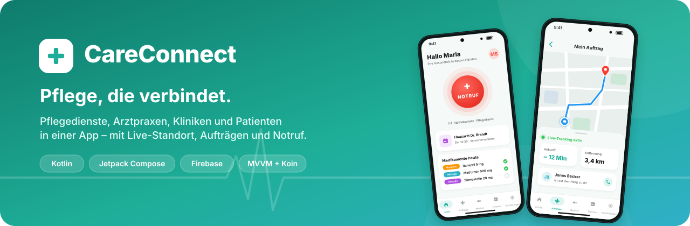
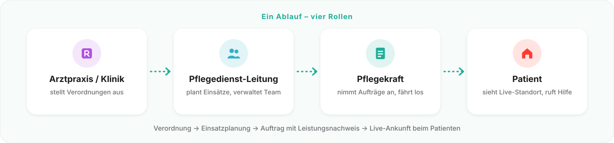
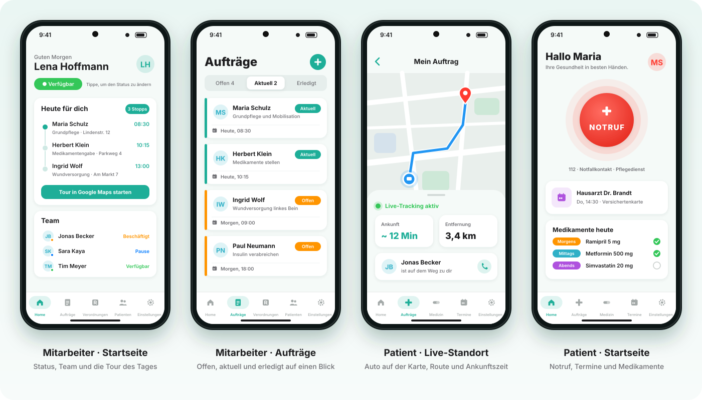
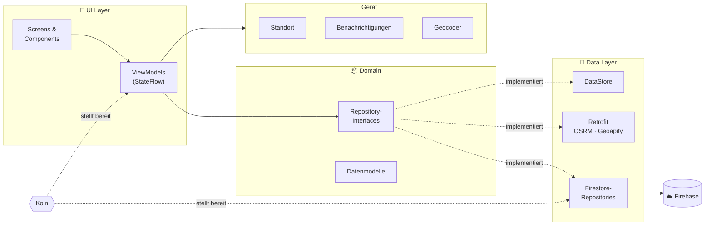
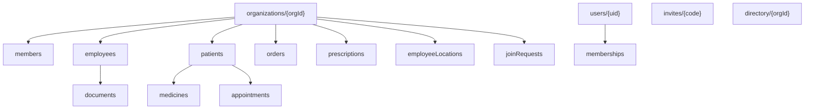

<div align="center">



<br/>


-3DDC84?style=for-the-badge&logo=android&logoColor=white)


**Die All-in-One-App für die ambulante Pflege.**<br/>
Pflegedienste, Arztpraxen, Kliniken und Patienten arbeiten in einer App zusammen –<br/>
von der Verordnung über den Einsatz bis zur Live-Ankunft an der Haustür.

[Features](#-features) · [Vorschau](#-vorschau) · [Technik](#-technik) · [Architektur](#-architektur) · [Projekt starten](#-projekt-starten)

</div>

---

## 💡 Die Idee

In der Pflege laufen viele Absprachen noch über Telefon, Zettel und Faxgeräte. Die Arztpraxis schickt eine Verordnung, der Pflegedienst plant Einsätze per Excel, und der Patient weiß nicht, wann jemand kommt.

**CareConnect bringt alle Beteiligten in eine App.** Jede Organisation hat ihren eigenen Bereich, jede Rolle sieht genau das, was sie braucht. Der Patient sieht wie bei einem Lieferdienst, wo seine Pflegekraft gerade ist und wann sie ankommt.

<div align="center">

</div>

---

## 📱 Vorschau

<div align="center">

<br/>
<sub><i>Illustrierte Vorschau der Oberfläche · Namen und Daten sind Beispiele</i></sub>
</div>

---

## ✨ Features

<table>
<tr>
<td width="50%" valign="top">

### 🏢 Organisationen & Rollen
- Pflegedienste, Arztpraxen und Kliniken gründen ihre **eigene Organisation**
- Beitritt per **Einladungscode** oder **Suche mit Beitrittsanfrage**
- Rollen: **Leitung**, **Mitarbeiter**, **Patient**
- Leitung verwaltet Anfragen, Codes und Mitglieder
- Wechsel zwischen mehreren Organisationen

</td>
<td width="50%" valign="top">

### 📝 Aufträge & Leistungsnachweis
- Aufträge nach **Offen · Aktuell · Erledigt**
- Annehmen mit **Transaktion**, damit niemand doppelt annimmt
- Abschluss mit **Notiz und Unterschrift mit dem Finger**
- Patienten sehen ihre Aufträge mit **Status-Verlauf**

</td>
</tr>
<tr>
<td width="50%" valign="top">

### 🚗 Live-Standort
- Patient sieht die Pflegekraft als **Auto auf der Karte**
- **Strecke als Linie** und **Ankunftszeit**
- Geteilt wird nur während eines laufenden Auftrags
- Nur mit **Zustimmung von beiden Seiten**
- OpenStreetMap-Karte, Routing über OSRM – **kein API-Key nötig**

</td>
<td width="50%" valign="top">

### 📄 Verordnungen
- Praxen und Kliniken schicken Verordnungen an den **freigegebenen Pflegedienst**
- Übernahme als **einzelner** oder **wiederkehrender Einsatz**<br/>(z. B. Mo / Mi / Fr für 4 Wochen)

</td>
</tr>
<tr>
<td width="50%" valign="top">

### 🏠 Startseiten pro Rolle
- **Mitarbeiter:** eigener Status (Verfügbar, Beschäftigt, Pause …), Team-Übersicht und „Heute für dich“ mit Tour in Google Maps
- **Patient:** großer **Notruf-Button** – 112, Notfallkontakt oder Pflegedienst

</td>
<td width="50%" valign="top">

### 🧑‍🤝‍🧑 Patienten, 💊 Medikamente, 📅 Termine
- Patientenprofil mit Kontakt, Notfallkontakt, Allergien und Vorgeschichte
- Medikamente nach **Morgens · Mittags · Abends**
- Termine mit Adresse und Dingen zum Mitbringen

</td>
</tr>
<tr>
<td width="50%" valign="top">

### 🔔 Benachrichtigungen
- Mitarbeiter: neue Aufträge und Verordnungen – **nur während der Arbeitszeit**
- Patienten: Auftrag angenommen, erledigt, geändert oder abgesagt

</td>
<td width="50%" valign="top">

### 🌍 Sprachen & Darstellung
- **Deutsch, Englisch, Türkisch, Arabisch** (von rechts nach links) und **Spanisch**
- Sprache direkt in der App umschaltbar
- **Hell- und Dunkelmodus**

</td>
</tr>
</table>

---

## 🛠 Technik

| Bereich | Umsetzung |
|---|---|
| **Sprache & UI** | Kotlin, Jetpack Compose, Material 3 |
| **Architektur** | MVVM mit Repository Pattern |
| **Dependency Injection** | Koin |
| **Backend** | Firebase Authentication, Cloud Firestore, Cloud Storage |
| **Navigation** | Navigation Compose mit typsicheren Routen |
| **Lokale Daten** | DataStore Preferences |
| **Texte & Sprachen** | `strings.xml` in 5 Sprachen, App-Sprache über `AppCompatDelegate` |
| **Netzwerk** | Retrofit + Moshi + OkHttp-Logging (Routing über OSRM, optional Geoapify) |
| **Bilder & Dateien** | Coil, Photo Picker, Activity Result API |
| **Karte** | osmdroid (OpenStreetMap-Daten) |
| **Standort** | FusedLocationProvider |

---

## 🏛 Architektur



- **Jedes Composable hat eine eigene Datei mit Preview.** Die Previews laufen über die Mocks in `mock/repository` – dafür braucht man weder Firebase noch Koin.
- **Live-Daten überall:** Firestore-`SnapshotListener` werden per `callbackFlow` zum `Flow` und landen über `StateFlow` direkt in der UI.
- **Navigation mit Argumenten:** Detail-Screens holen ihre ID über `SavedStateHandle.toRoute()` im ViewModel.
- **Fehler werden abgefangen** (`Result`, `runCatching`) und in der Oberfläche verständlich angezeigt.

<details>
<summary><b>🗂 Datenmodell in Firestore</b></summary>

<br/>

Alle Daten liegen pro Organisation getrennt. So sieht jede Organisation nur ihre eigenen Patienten, Aufträge und Verordnungen.



Die Zugriffsregeln stehen in [`firestore.rules`](firestore.rules) und [`storage.rules`](storage.rules).

</details>

<details>
<summary><b>📁 Projektstruktur</b></summary>

<br/>

```
app/src/main/java/com/example/careconnect
├── di/                 App-Klasse (startet Koin) und Koin-Modul
├── domain/
│   ├── model/          Datenmodelle (je Klasse/Enum eine Datei)
│   └── repository/     Repository-Interfaces
├── remote/
│   ├── api/            Retrofit (Geoapify, OSRM)
│   ├── FirestoreListener.kt  SnapshotListener als Flow
│   ├── model/          DTOs mit Mappern
│   └── repository/     Firestore-Implementierungen
├── local/              DataStore (Einstellungen)
├── mock/               Beispieldaten und Repository-Mocks für die Previews
├── service/            Standort-Tracking und Benachrichtigungen
├── session/            Aktuelle Organisation
├── platform/           Karte, Geocoder, Standort, Benachrichtigungen
├── i18n/               Auswählbare App-Sprachen
├── ui/                 Screens, Komponenten und ViewModels pro Feature
├── util/               Helferklassen (Datum, Texte, Dateien, Links)
└── MainActivity.kt     Einstieg, Berechtigungen

app/src/main/res/values*/strings.xml   Texte auf Deutsch, Englisch, Türkisch, Arabisch, Spanisch
```

</details>

---

## 🚀 Projekt starten

**Voraussetzungen**
- Android Studio (aktuelle Version)
- Ein Firebase-Projekt mit Authentication (E-Mail/Passwort), Firestore und Storage

**Firebase einrichten**
1. `google-services.json` nach `app/` legen
2. Inhalt von `firestore.rules` und `storage.rules` in der Firebase-Konsole veröffentlichen

**Starten**
```bash
./gradlew :app:assembleDebug
```
oder in Android Studio die Run-Konfiguration `app` starten.

<details>
<summary><b>⚙️ Optional</b></summary>

<br/>

- Geoapify-Key in `remote/Secrets.kt` eintragen – dann gibt es Adressvorschläge beim Tippen
- Im Emulator unter **⋯ → Location** einen Standort oder eine Route setzen, um den Live-Standort zu testen

</details>

---

## 🔭 Ausblick

- [ ] Push-Benachrichtigungen mit Firebase Cloud Messaging, auch wenn die App geschlossen ist
- [ ] Unit- und UI-Tests für ViewModels und wichtige Screens
- [ ] Export des Leistungsnachweises als PDF
- [ ] Veröffentlichung im Google Play Store

---

<div align="center">

### 👤 Autor

**Ali Chehab**<br/>
Abschlussprojekt im Android-Modul am Syntax Institut

[](https://github.com/Ali-C313)

</div>
